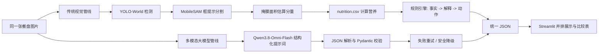

# FoodCoach · PlateLens 餐盘透镜

PlateLens 是 **FoodCoach** 的“单餐视觉评估”切片：对同一张餐盘图片并行运行传统视觉方案与多模态大模型方案，并排比较识别、定位、营养估算和诚实反馈。

> 食物识别、分量与营养数值均为估算，不构成医疗或营养建议。

## 项目解决什么问题

健身人群拍下食堂或自制的单餐后，需要快速知道“这顿大概吃了什么、热量和蛋白质是否明显偏离目标、下一顿怎么调整”。PlateLens 不追求虚假的精确称重，而是提供：

- 传统方案：可追溯的类别、边界框、分割掩膜、面积换算和营养表计算
- 大模型方案：对混合菜和自然语言情境更灵活的识别与解释
- 同一输入上的逐项对比：什么结果一致、什么结果分歧、各自适合什么场景

## 两种方案



### 传统方案

- YOLO-World 零样本检测，不在本次范围内重新训练检测器
- MobileSAM 使用检测框作为提示生成像素级掩膜
- 掩膜面积 / 餐盘参考面积 + 食材厚度和密度，输出克数区间
- 查询 20 种食材的本地营养表
- 规则引擎明确判断热量、蛋白质和碳水占比，再给出最小可执行动作

### 多模态方案

- 默认使用阿里云百炼的 Qwen3.8-Omni-Flash，通过 OpenAI 兼容接口调用；如果 Flash 在固定测试集上的识别或 JSON 稳定性不足，再切换到 Qwen3-VL-Plus
- 输入图片、用户简况、目标和用餐情境
- 要求模型返回固定 JSON，服务端用 Pydantic 二次校验
- JSON 无效时修复一次，仍失败则明确报错，不伪造结果
- 建议措辞含羞辱或软化事实时，用规则建议兜底并写入警告

## 功能范围

支持单张餐盘图片，以及以下 20 类常见食材：

鸡胸肉、鸡蛋、米饭、西兰花、牛肉、三文鱼、南瓜、胡萝卜、橙子、豆腐、花菜、生菜、番茄、紫甘蓝、全麦面包、土豆、玉米、蘑菇、猪肉、青椒。

不支持：注册登录、多用户并发、长期饮食记录、健身计划管理、移动端、精确称重。

## 快速开始

### 1. 环境

推荐使用项目现有的 `lingjing-ai` Conda 环境；该环境已包含 CUDA 12.8 的 PyTorch。

```powershell
F:\Miniforge3\envs\lingjing-ai\python.exe -m pip install -r requirements.txt
```

若需要重新安装 GPU 版 PyTorch：

```powershell
F:\Miniforge3\envs\lingjing-ai\python.exe -m pip install -r requirements-torch.txt
```

### 2. 配置多模态 API

复制 `.env.example` 为 `.env`，填写阿里云百炼 API Key：

```env
DASHSCOPE_API_KEY=你的本地密钥
VLM_MODEL=qwen3.8-omni-flash
```

`.env` 已被 Git 忽略，禁止把 Key 提交到仓库。未配置 Key 时，传统方案仍可运行，大模型方案会明确显示为不可用。

### 3. 下载模型权重

```powershell
F:\Miniforge3\envs\lingjing-ai\python.exe scripts\download_models.py
```

首次运行还会下载 YOLO-World 使用的 CLIP 文本编码器。模型权重位于 `models/` 或 Ultralytics 缓存目录，不进入 Git。

### 4. 启动

分别打开两个终端：

```powershell
.\scripts\run_api.ps1
```

```powershell
.\scripts\run_ui.ps1
```

浏览器打开 <http://127.0.0.1:8501>。API 文档位于 <http://127.0.0.1:8000/docs>。

也可以运行 `.\scripts\run_all.ps1`，脚本会后台启动 API，再启动 Streamlit。

### 5. Docker / Linux 部署

本项目已验证可在 Ubuntu 24.04 + Docker Compose 环境运行。推荐使用 CPU 实例，服务器至少 2 核 4G；低内存实例需要配置 Swap。

服务器上准备：

```bash
sudo apt-get update
sudo apt-get install -y docker.io docker-compose-v2
sudo usermod -aG docker $USER
newgrp docker
```

把项目代码、`models/` 中的 YOLO/SAM 权重以及 `.env` 上传到服务器。`.env` 不进入 Git，必须通过环境变量或单独上传配置。上传后请限制权限：

```bash
chmod 600 .env
```

YOLO-World 还需要 CLIP 文本编码器；如果服务器没有缓存，可提前下载到项目的 `weights/clip/`，Compose 会以只读方式挂载该目录：

```bash
mkdir -p weights/clip
curl -L --fail -o weights/clip/ViT-B-32.pt \
  https://openaipublic.azureedge.net/clip/models/40d365715913c9da98579312b702a82c18be219cc2a73407c4526f58eba950af/ViT-B-32.pt
```

启动完整服务：

```bash
docker compose up -d --build
docker compose ps
```

服务器防火墙或安全组至少放行：

- `8000/tcp`：FastAPI 和接口文档
- `8501/tcp`：Streamlit 页面

访问地址：

```text
http://<服务器公网IP>:8501/
http://<服务器公网IP>:8000/docs
```

首次加载 YOLO-World、CLIP 和 MobileSAM 时 CPU 推理会明显变慢，后续请求会复用已加载模型。若 Docker Hub 拉取基础镜像超时，可先从可用镜像源拉取 `python:3.11-slim` 并重新标记为同名镜像。

## API

### 健康检查

```http
GET /api/v1/health
```

### 食材目录

```http
GET /api/v1/catalog
```

### 双方案评估

```http
POST /api/v1/assess
Content-Type: multipart/form-data
```

字段：

- `image`：JPG / PNG / WebP，最大 12 MB
- `height_cm`
- `weight_kg`
- `body_fat_pct`：可选
- `goal`：`fat_loss` / `muscle_gain` / `maintain`
- `context`：`pre_workout` / `post_workout` / `rest_day` / `snack`
- `plate_diameter_cm`：默认 26 cm

响应同时包含 `traditional`、`vlm` 和 `comparison`，关键字段示例：

```json
{
  "foods": [
    {
      "name": "鸡胸肉",
      "confidence": 0.91,
      "bbox": [120, 80, 310, 270],
      "mask_area_ratio": 0.08,
      "estimated_grams": [95.0, 176.0],
      "nutrition": {
        "calories": 224,
        "protein_g": 42.1,
        "carbs_g": 0.0,
        "fat_g": 4.9,
        "note": "按食物参考值估算"
      }
    }
  ],
  "totals": {"calories": 224, "protein_g": 42.1, "carbs_g": 0.0, "fat_g": 4.9},
  "verdict": {
    "calorie_status": "不足",
    "protein_status": "充足",
    "carb_ratio": "适中",
    "summary": "本餐估算约 224 kcal……"
  },
  "advice": ["若这是正餐，可补充少量主食和蔬菜。"],
  "long_term_note": "单顿不决定结果，关注连续多天的整体趋势。",
  "disclaimer": "仅供学习参考，不构成医疗或营养建议。"
}
```

## 示例输出

- 实际运行导出的示例：[example_output.json](docs/examples/example_output.json)
- 重新导出当前示例：

```powershell
F:\Miniforge3\envs\lingjing-ai\python.exe scripts\export_example.py
```

## 测试

```powershell
F:\Miniforge3\envs\lingjing-ai\python.exe -m pytest -q
```

测试覆盖数据规模、营养计算、目标估算、规则反馈、分量换算、VLM JSON 解析、对比逻辑和 API 上传校验。

## 项目结构

```text
app/
  main.py                 FastAPI 路由
  schemas.py              统一数据契约
  catalog.py              食材与别名词典
  nutrition.py            营养计算
  rule_engine.py          诚实反馈规则
  services/
    traditional.py        YOLO-World + MobileSAM
    portion.py            掩膜面积到克数区间
    vlm.py                Qwen3.8-Omni-Flash 调用、重试与校验
    comparison.py         两方案逐项对比
frontend/
  streamlit_app.py        并排演示页面
data/
  nutrition.csv           20 种食材参考值
  samples/                固定示例图片
docs/                     架构、对比、考核映射与项目说明
scripts/                  模型下载与启动脚本
tests/                    自动化测试
```

## 已知限制

1. YOLO-World 对中餐混合菜和遮挡场景可能漏检或重复检测，本项目的置信度不等于准确率。
2. 单张图片没有深度和真实尺度，克数只能根据掩膜面积、餐盘直径和食材密度给出区间。
3. 烹饪油、酱汁和混合菜会显著影响营养值，营养表无法覆盖所有做法。
4. 多模态模型可能产生数值幻觉；本项目会做结构和范围校验，但不能保证客观正确。
5. 当前为单机演示版，未实现多用户、任务队列和持久化。

## 文档

- [项目构想与实现说明](docs/PlateLens项目构想与实现说明.docx)
- [架构说明](docs/PlateLens架构说明.docx)
- [方案对比](docs/两种方案对比.docx)

## 参考与创新

项目参考了课程中的 YOLO、SAM、多模态 API 调用与结构化提示词方法。PlateLens 的具体选题、统一双方案输出、掩膜面积估算流程、规则引擎与并排对比页面为本项目自主实现。第三方模型和示例图片来源在文档中注明。
